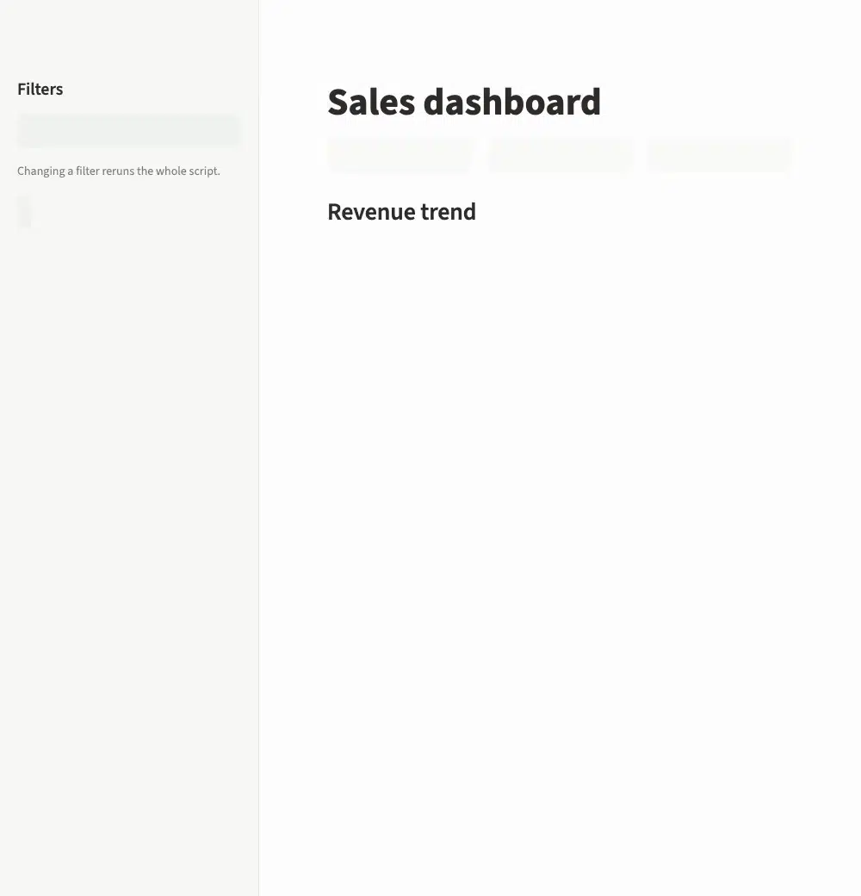
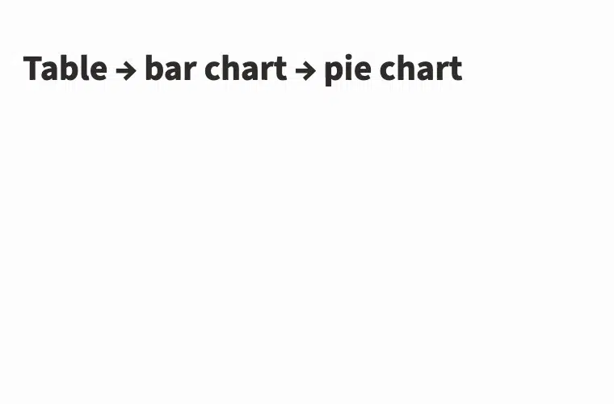
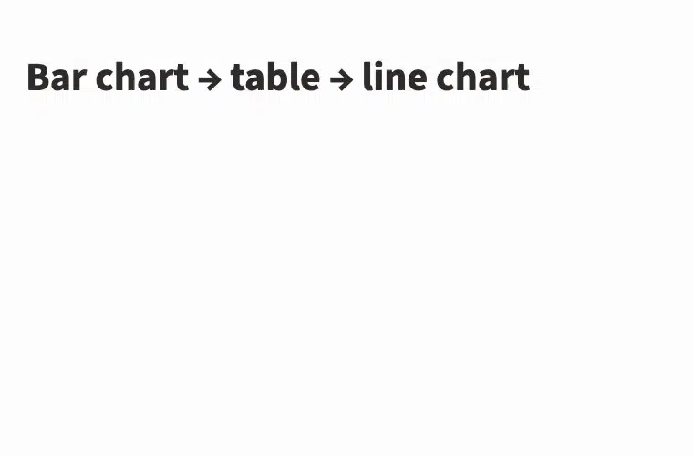
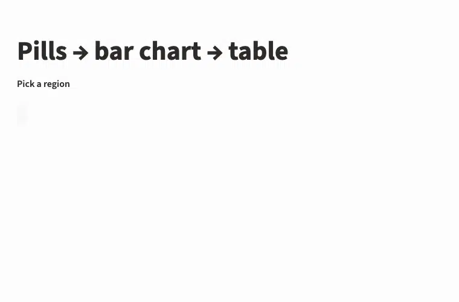
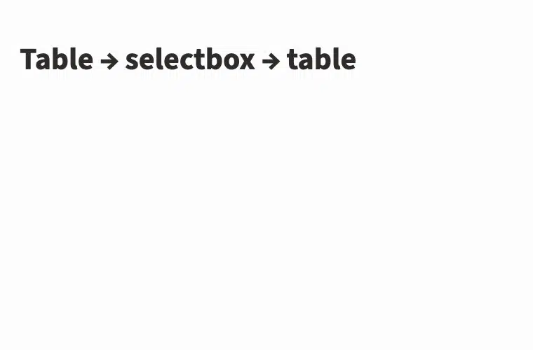
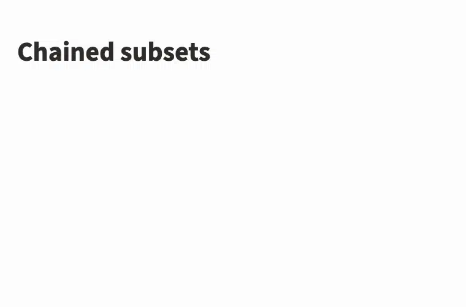

# streamlit-drilldown

Drill down through linked Streamlit elements, one level at a time. A selection in one level (a row, a bar, a pill, a selectbox choice) opens the next level in the same place. A back button and a breadcrumb are built in.



The demo app above ([`examples/dashboard_app.py`](examples/dashboard_app.py)) has a sidebar filter, KPIs, a slow chart and a drilldown. The counters at the top belong to the script. They stay the same while you drill, and only change when the filter reruns the whole script. Only the drilldown reruns, as a fragment.

```python
drilldown(
    [
        {"title": "Revenue by region", "element": st.dataframe,     "loader": regions_table},
        {"title": "Countries",         "element": st.echarts_chart, "loader": countries_bar},
        {"title": "Product share",     "element": st.echarts_chart, "loader": products_pie},
    ],
    key="sales",
)
```

- **Any element works.** A level is any Streamlit command that returns a value and accepts `key`: `st.dataframe`, `st.echarts_chart`, `st.plotly_chart`, `st.selectbox`, `st.pills`, and so on.
- **Fast.** Only the fragment around the drilldown reruns when you drill or go back, not the whole script.
- **No session state in your code.** The drilldown keeps the selections, the navigation and the widget keys.
- **Each loader runs once** per level you visit, so heavy processing happens once.

## Install

```bash
pip install git+https://github.com/raethlein/streamlit_drilldown.git
```

It needs Streamlit 1.64 or later (`st.fragment(key=...)` since 1.63, `st.echarts_chart` since 1.64 for the examples) and Python 3.11 or later.

## Quick start

```python
import pandas as pd
import streamlit as st
from streamlit_drilldown import drilldown, selected_row

orders = pd.DataFrame(
    {
        "region": ["Europe", "Europe", "Asia", "Asia"],
        "country": ["Germany", "France", "Japan", "India"],
        "revenue": [10, 20, 30, 40],
    }
)


def regions(element):
    df = orders.groupby("region", as_index=False)["revenue"].sum()
    element(df, selection_mode="single-row", hide_index=True)
    return selected_row(df, "region")


def countries(element, region):
    # The last level returns nothing: there is nothing left to drill into.
    element(orders[orders["region"] == region], hide_index=True)


drilldown(
    [
        {"title": "Regions", "element": st.dataframe, "loader": regions},
        {"title": "Countries", "element": st.dataframe, "loader": countries},
    ],
    key="sales",
)
```

Click a row in the first table to open the second. **Back** returns to the first.

## How it works

`drilldown(levels, key=...)` takes the hierarchy, top level first. Every level is a dict:

| Key | Meaning |
| --- | --- |
| `element` | The Streamlit command that shows the level, for example `st.dataframe`. |
| `loader` | A function `loader(element, *selections)` that renders the level. |
| `title` | Optional heading above the level. |

### Loaders

A loader renders its level by calling the `element` it receives, with the same arguments you would pass to the real command. It also gets the selections made in the levels above, as positional arguments. A loader for the third level is `loader(element, first_selection, second_selection)`.

The `element` argument already has `key` and the selection callback wired in. Do not pass `key`, `on_select`, `on_change` or `on_click` yourself.

### Resolvers

A loader returns a **resolver**: a small function that turns the element's value into the selection for the next level. It returns `None` while nothing is selected, and the drilldown does not drill. The last level's loader returns nothing.

```python
def regions(element):
    df = heavy_query()                                  # runs once
    element(df, selection_mode="single-row")
    return lambda event: df.iloc[event.selection.rows[0]]["region"] if event.selection.rows else None
```

The resolver closes over the loader's data, so the loader never has to run again to find out what the user picked.

Resolvers for the common elements are included:

| Helper | Use with | Selection |
| --- | --- | --- |
| `selected_row(df, column)` | `st.dataframe` with `selection_mode="single-row"` | The value in `column` of the selected row. |
| `selected_point(names)` | `st.echarts_chart` with `selectedMode` set on the series | The name of the selected data point. `names` follow the chart's data order. |
| `value` | `st.pills`, `st.selectbox`, `st.radio`, ... | The widget's value. |

For other elements, write a one-line resolver. The function receives whatever the element returns.

### Widgets with a default value

A widget that always has a value, such as `st.selectbox`, needs `index=None` so it starts without a choice. Otherwise it would drill down by itself as soon as it appears. See [`examples/table_selectbox_table.py`](examples/table_selectbox_table.py).

### Navigation

Selecting an item opens the next level. **Back** returns to the previous level, and the next visit starts without a selection. The breadcrumb next to the button shows the selections so far, for example `Europe › Germany`.

## Examples

Each example is a runnable app. `dashboard_app.py` is the main one, shown at the top. Install the package, then run one with `streamlit run`:

```bash
pip install -e .
streamlit run examples/dashboard_app.py
```

| Example | Levels | Shows |
| --- | --- | --- |
| [`dashboard_app.py`](examples/dashboard_app.py) | DataFrame → bar chart → DataFrame, inside a bigger app | Drilling reruns only the drilldown fragment, not the whole script. |
| [`table_bar_pie.py`](examples/table_bar_pie.py) | DataFrame → bar chart → pie chart | Mixing `st.dataframe` and `st.echarts_chart`. |
| [`bar_table_line.py`](examples/bar_table_line.py) | Bar chart → DataFrame → line chart | Starting with a chart. |
| [`pills_bar_table.py`](examples/pills_bar_table.py) | Pills → bar chart → DataFrame | A widget as a level, with the `value` resolver. |
| [`table_selectbox_table.py`](examples/table_selectbox_table.py) | DataFrame → selectbox → DataFrame | A selectbox with `index=None`. |
| [`four_tables.py`](examples/four_tables.py) | Four DataFrames | One loader factory for similar levels. |
| [`chained_subsets.py`](examples/chained_subsets.py) | Four DataFrames, large data | Filtering the cached subset of the level above. |

**[`table_bar_pie.py`](examples/table_bar_pie.py)**: DataFrame → bar chart → pie chart



**[`bar_table_line.py`](examples/bar_table_line.py)**: Bar chart → DataFrame → line chart



**[`pills_bar_table.py`](examples/pills_bar_table.py)**: Pills → bar chart → DataFrame



**[`table_selectbox_table.py`](examples/table_selectbox_table.py)**: DataFrame → selectbox → DataFrame



**[`four_tables.py`](examples/four_tables.py)**: Four DataFrames


**[`chained_subsets.py`](examples/chained_subsets.py)**: Four DataFrames, large data



[`examples/sample_data.py`](examples/sample_data.py) holds the sample data, the cached queries and the chart specs that the examples share.

## Performance

The drilldown reruns a fragment on every drill, so keep the work per level small.

- **Cache the data access, not the loaders.** A loader renders widgets and returns a function, so `st.cache_data` cannot cache it. Put the query or the aggregation in a `@st.cache_data` function and call it from the loader, as `sample_data.revenue_by` does.
- **Filter smaller frames.** For a large DataFrame, build each level from the cached subset of the level above instead of filtering the full frame every time. [`examples/chained_subsets.py`](examples/chained_subsets.py) shows the pattern with a recursive `@st.cache_resource` function. `st.cache_resource` returns the stored DataFrame without copying it, so do not modify it, and bound the cache with `max_entries` or `ttl`.
- **Loaders run once per visit.** A loader runs when its level is shown, including after **Back** and on a full-page rerun. It does not run again after a selection.

## Limits

- Every drill is a round trip to Python, because the next level is rendered by a fragment rerun. For large data that only drills in memory, a client-side drilldown would avoid the round trip.
- An element without an `on_select`, `on_change` or `on_click` parameter is resolved after it renders, which takes one extra fragment run.
- A drilldown shows one level at a time. Several drilldowns on a page are independent, each with its own `key`.
- The loaders and resolvers are not cached or serialized, so they can close over any Python object.

## Development

```bash
uv sync
uv run pytest
```

`uv run python scripts/record_demos.py` re-records the videos in `docs/` (it needs `uv run playwright install chromium`).

The tests run every example through Streamlit's `AppTest` and test drilling down and back with a selectbox drilldown.

## Using it with an AI coding agent

The repository has a skill for coding agents at [`.claude/skills/using-streamlit-drilldown/SKILL.md`](.claude/skills/using-streamlit-drilldown/SKILL.md). It points agents to this README.

## License

[Apache License 2.0](LICENSE).
